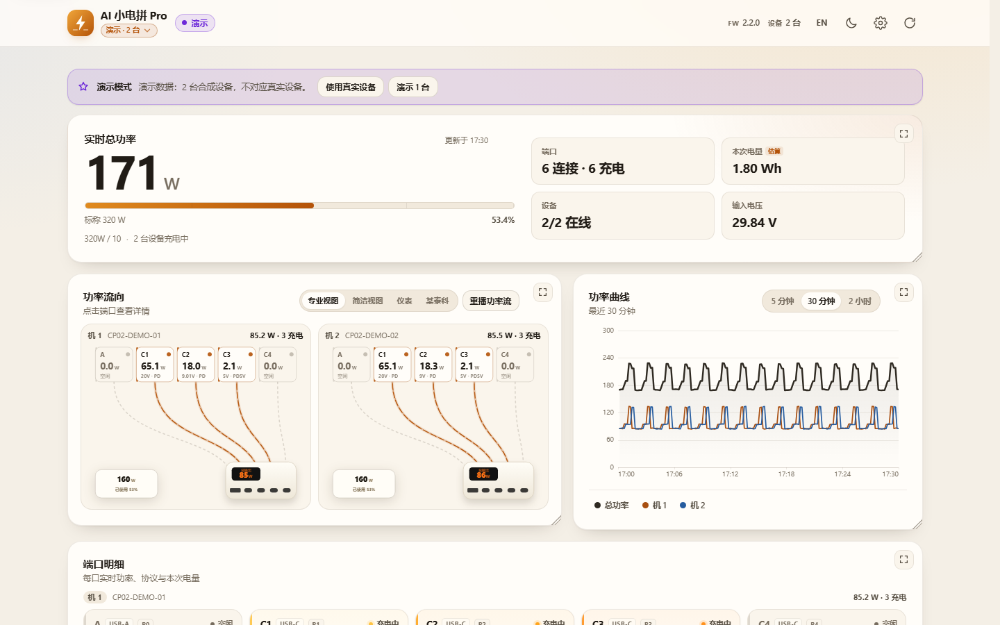
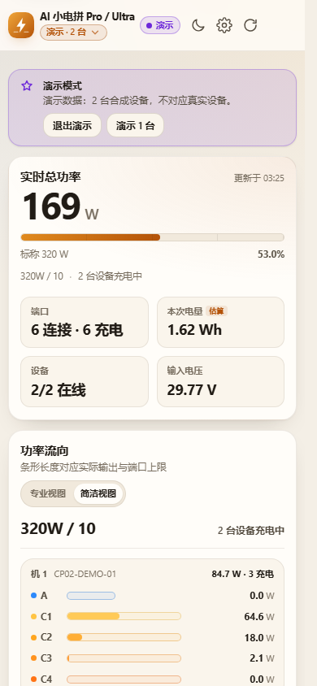
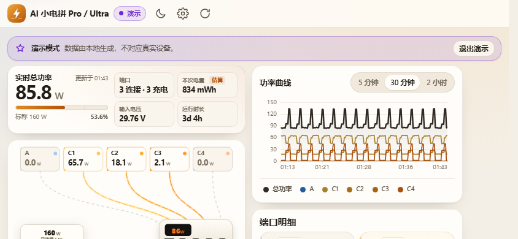
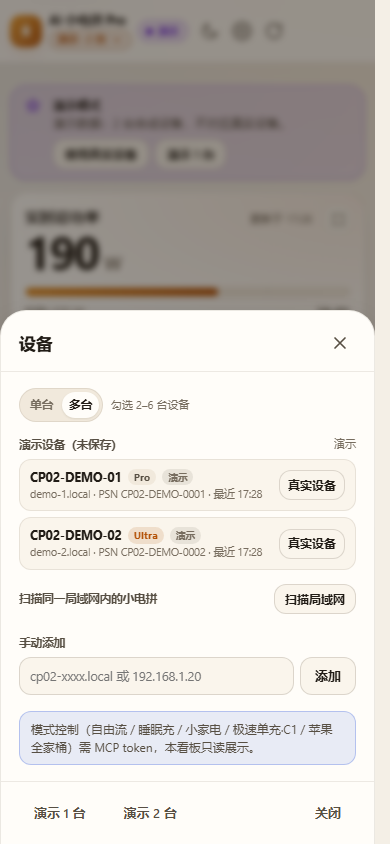
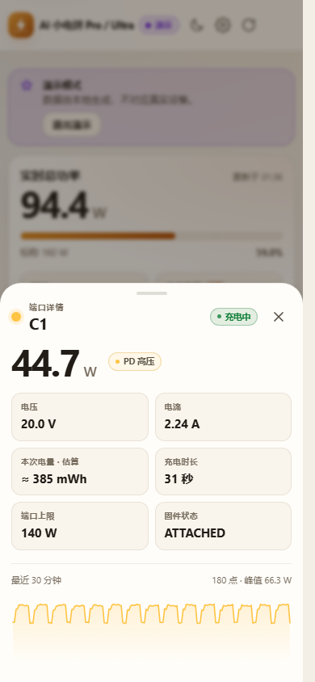
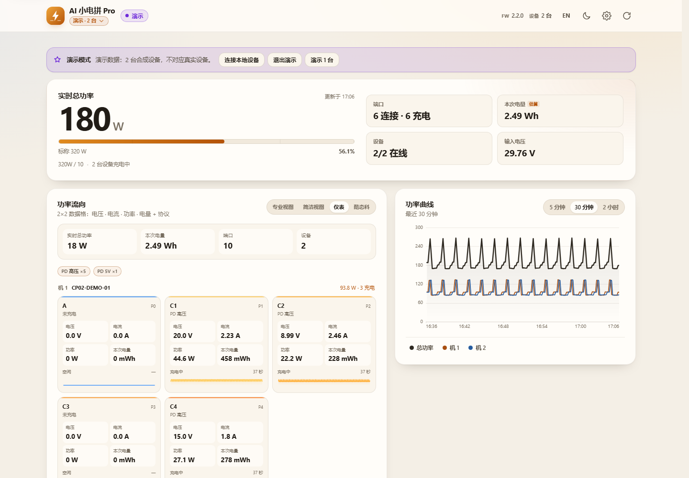
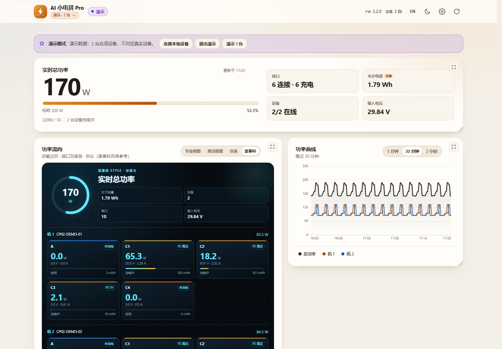

# AI 小电拼 · 实时功率看板

> 一个**只读、零依赖**的局域网 Web 仪表盘，把 CANDYSIGN 制糖工厂 AI 小电拼（CP-02 / Pro / Ultra，160 W 4C1A）的
> 五口实时功率、电压、电流、协议、充电时长与累计电量，画成 App 同款的功率分布图。
> 支持扫描/选择设备、多台一起看（P0–P4、P5–P9…）、专业/简洁/仪表/某泰科四种视图。
> 不装 App、不登录账号、不需要 MCP token，也不会修改充电器的任何设置。
>
> **许可证：PolyForm Noncommercial 1.0.0 — 禁止商用**（非 OSI 开源，source-available）。

[](LICENSE)
[](https://nodejs.org)
[](#)
[](https://wzqvip.github.io/cocan-ultra-dashboard/)

<p align="center">
  <a href="https://wzqvip.github.io/cocan-ultra-dashboard/">
    
  </a>
</p>

## 在线网页

GitHub Pages 上已经编译部署好的在线网页（点击图片或下面链接打开）：

- [打开在线看板](https://wzqvip.github.io/cocan-ultra-dashboard/)
- [直接看双设备演示（P0–P9）](https://wzqvip.github.io/cocan-ultra-dashboard/?demo=2)
- [直接看六设备演示（P0–P29）](https://wzqvip.github.io/cocan-ultra-dashboard/?demo=6)
- [连接本地设备（需 Chrome 本地网络权限 + 本机代理）](https://wzqvip.github.io/cocan-ultra-dashboard/?local=1)
- [GitHub 仓库](https://github.com/wzqvip/cocan-ultra-dashboard)

> Pages 上是**演示模式**。Chrome 142+ 可以弹出“访问本地网络”权限，但设备的 HTTP 服务
> **没有 CORS 头、OPTIONS 也返回 405**，所以不能把 Pages 直接指向设备 `/metrics.json`；
> 必须在本地跑 `server.mjs` 作为代理。

### 在 Pages 里连接本地设备

1. 本机运行：
   ```bash
   node server.mjs --host cp02-<PSN>.local
   ```
2. 打开 Pages，点演示横幅里的 **「使用真实设备」**，或访问：
   ```text
   https://wzqvip.github.io/cocan-ultra-dashboard/?local=1
   ```
3. Chrome 询问本地网络权限时点 **允许**；如果首次自动连接没有弹窗，点页面上的 **重试** 触发权限请求。

页面会通过 `http://127.0.0.1:8787` 读真机；代理端口不是 8787 时用
`?api=http://127.0.0.1:<port>`。Chrome 的权限弹窗只解决混合内容/本地网络，
**不绕过设备 CORS**；详见 [docs/LOCAL-CONNECTION.md](docs/LOCAL-CONNECTION.md)。

### 演示模式与真实模式

- **GitHub Pages 默认是演示模式**。点演示横幅里的 **「使用真实设备」** 会跳到
  `?local=1`（不是单纯删掉 `?demo`，否则 github.io 仍会回到演示）。
- 本地用 `node server.mjs` 打开时，同一个按钮会直接退出演示并读真实设备。
- 设备弹窗里演示设备标题是 **“演示设备（未保存）”**，不会冒充已保存设备；
  每行的 **「真实设备」** 按钮就是切回真实模式。
- 真实设备每行右侧有 **「选择 / 已选择」**；多台模式也有「选择」按钮，可直接切回单台查看。
- Pages 切真实模式仍需要本机 `server.mjs` 代理；没有代理时会显示“本地代理模式”提示。

| 竖屏（2 台演示） | 横屏（2 台演示） |
| --- | --- |
|  |  |

> 截图使用**演示数据**（`?demo=2`），不包含真实设备的 PSN / MAC / SSID / IP。

## 文档导航

| 文档 | 内容 |
| --- | --- |
| [在线看板](https://wzqvip.github.io/cocan-ultra-dashboard/) | GitHub Pages 编译产物，演示数据 |
| [Pro / Ultra 适配说明](docs/PRO-ULTRA.md) | 型号识别、混用、Pro/Ultra 差异、已测范围 |
| [数据契约](docs/DATA-CONTRACT.md) | `/api/snapshot`、`/api/multi`、`/api/history` 字段与单位 |
| [App 对齐规格](docs/APP-PARITY.md) | 官方 App UI、功率图、协议语义、来源与风险 |
| [MQTT / MCP / 授权](docs/MQTT-AND-LICENSING.md) | MCP 获取、自定义 broker、feature bit、实测与还原流程 |
| [Pages 连接本地设备](docs/LOCAL-CONNECTION.md) | Chrome LNA、CORS 限制、`?local=1` / `?api=` |
| [README](README.md) | 本页：功能、快速开始、部署、排错 |
| [LICENSE](LICENSE) | PolyForm Noncommercial 1.0.0（禁止商用） |
| [GitHub Actions](.github/workflows/pages.yml) | Pages 构建/部署流程 |

---

## 这是什么

小电拼 CP-02 本机自带一个 IonBridge HTTP 服务，暴露了：

- `GET /metrics.json`：五口实时电压/电流/协议/状态/会话电量，系统与 Wi-Fi 信息（推荐）
- `GET /metrics`：Prometheus 文本格式（同样数据，字段更少）
- `GET /porthistoryz?limit=180`：设备内存里约 30 分钟、10 秒/点的电压电流历史
- `GET /`：设备身份（PSN、型号、固件版本、端点列表）

这些接口**没有 CORS 头**，浏览器直接 `fetch` 会被拦；GitHub Pages 是 HTTPS，直接请求
`http://` 设备还会触发混合内容限制。所以本项目附带一个零依赖的本地 Node 代理：
它把设备数据归一化后，和静态页面同源提供。

```
┌────────────┐    same-origin     ┌──────────────┐    LAN / no CORS    ┌──────────────┐
│  Browser   │ ─────────────────► │  server.mjs  │ ──────────────────► │  CP-02       │
│  dashboard │  /api/snapshot     │  (Node 18+)  │  /metrics.json      │  IonBridge   │
└────────────┘                    └──────────────┘  /metrics           └──────────────┘
```

## 已验证设备

目前只对 **CP-02 Pro** 做了实机测试；其他型号没有硬件，不能声称已实测。

| 设备 | 状态 |
| --- | --- |
| **CP-02 Pro**（固件 2.2.0，ESP32-C3，SW3566 0.3.36，FPGA 0.2.9，hw MP0，160W 4C1A） | ✅ 实机验证：单台、扫描、多台（同设备双别名）、Pro/Ultra 混用演示、局域网数据、Prometheus、历史、设置、响应式 |
| CP-02 Ultra | ⚠️ 未实机验证；按官方对比表/feature bit 适配，型号会显示 Ultra |
| CP-02S / Core / Mirror（CP-03） | ❌ 未验证；CP-02S 的屏显/待机/整点报时不在此项目范围 |

> 因此“测试了 CP-02”具体指 **CP-02 Pro / 2.2.0**；Ultra 的 Premium Kit 等能力没有被实机验证。

## Pro / Ultra 对比与适配

官方口径（[CANDYSIGN 对比表](https://weibo.com/2/detail/5346721887423088)）：Pro 与 Ultra **硬件相同**，
Ultra 多了 Premium Kit、状态屏颜色和 SKU 权益；**龙虾服务 / MCP 两者都支持**；Pro 可用「糖码」升级 Ultra。

| 项目 | Pro | Ultra | 看板怎么适配 |
| --- | --- | --- | --- |
| 硬件 | 160W、4C1A、C 140W、A 60W | 相同 | 同一套功率/端口/曲线 UI |
| 状态屏颜色 | 金珀色 | 琥珀色 | 不伪造硬件颜色，只显示型号/能力 |
| AI 充电系统 | FluxAI 2.0 | 2.0 + Premium Kit | 只读看板不实现写控制 |
| 龙虾服务 / MCP | ✅ | ✅ | **不按型号锁 MCP** |
| 糖码升级 | 可升级 Ultra | — | 能力判断优先看 license/feature bit，不只看 `device_model` |
| 型号显示 | `AI 小电拼 Pro` | `AI 小电拼 Ultra` | 从设备 `device_model` 自动读取，并同步已保存设备 |
| 混用多台 | ✅ | ✅ | 每台独立判断；P0–P4、P5–P9… |

更细的适配、feature bit 和未验证范围见 [docs/PRO-ULTRA.md](docs/PRO-ULTRA.md)。

## 功能

- **官方 App 双视图**：**专业视图**是 A、C1–C4 五个端口 chip 经贝塞尔线连到机身的功率流图
  （充电中的线有流动虚线，可“重播功率流”）；**简洁视图**是五条端口色功率线，
  实心长度=当前输出、浅色轨道=端口能力（A 60 W、C 140 W），对齐官方 App 的 `160W / 5` 表达。
- **仪表视图（Power-Z 风格）**：每个端口一张 2×2 数据格——电压、电流、功率、本次电量，
  外加协议、状态、充电时长和 30 分钟功率 sparkline；顶部有总功率/总电量/协议分布。
- **某泰科风格**：总输出环形仪表、每口大号功率、V/A、协议、功率条和本次电量；
  深色科技面板。仅视觉风格参考，非官方合作或复刻。
- **更多功率 UI**：四种视图都支持单台/多台、Pro/Ultra 混用；仪表和某泰科视图按设备
  分组，端口继续使用 P0–P4、P5–P9 编号。
- **面板自由调大小 / 单个全屏**：功率总览、功率流向、功率曲线、端口明细都可以拖右下角
  改尺寸，尺寸会记住；每块面板右上角有全屏按钮，适合手机、副屏或投屏只看一块。
- **实时总览**：总功率、在充口数、本次累计电量、DC 输入母线电压、开机时长。
- **Pro / Ultra 混用**：每台设备按 `device_model` 自动显示 **Pro** 或 **Ultra**；多台模式可同时
  加入 Pro 与 Ultra，列表、端口和聚合功率各自归属，不会把整页写死成某一种型号。
- **五口明细**：实时 W / V / A、快充协议（PD / PPS / QC / UFCS / VOOC…）、端口状态、
  本次充电时长、本次电量（由设备原始计数换算，±5% 估算）。
- **扫描并选择设备**：首次打开自动扫描本机 /24 网段，列出发现的小电拼（名称 / PSN / 主机 / RSSI），
  点选即可监看；也支持手动输入 IP、mDNS 主机名和保存多台设备。
- **多台一起看**：单台/多台模式切换；2 台设备按 **P0–P4、P5–P9** 编号，N 台依此类推；
  总功率按所有在线设备求和，支持单台掉线时的部分展示。
- **曲线**：设备自带 30 分钟历史 + 浏览器本地累积最长 2 小时（10 秒/点，仅页面打开期间）；
  多台模式显示各台总功率与合计。
- **响应式 / 横竖屏**：竖屏手机、横屏手机、平板、桌面四档布局；支持刘海安全区、
  `100dvh`、无横向滚动；手机横屏时自动切成左右两栏。
- **主题与语言**：浅色 / 深色（跟随系统或手动切换）；中文 / English。
- **数据源可切换**：自动 / `metrics.json` / Prometheus `/metrics`；Prometheus 模式会明确标注
  「不提供充电时长与累计电量」。
- **演示模式**：`?demo=1` … `?demo=6` 演示 1–6 台（2 台即 P0–P9）；GitHub Pages 自动演示，
  演示设备标为“演示设备（未保存）”，可一键切回真实模式。
- **无构建、无 npm 依赖、无 CDN**：原生 HTML/CSS/ES Modules，直接跑。

## 快速开始

需要 **Node.js 18+**（仅使用标准库，不需要 `npm install`）。

```bash
git clone https://github.com/wzqvip/cocan-ultra-dashboard.git
cd cocan-ultra-dashboard

# 把 <PSN> 换成你设备主机名里的序列号；也可以直接用 IP
node server.mjs --host cp02-<PSN>.local
```

打开 <http://127.0.0.1:8787>。默认端口是 8787；如果被占用或落在 Windows 保留端口段，
会自动顺延到下一个可用端口并在终端打印实际地址。

Windows 也可以双击 `start.bat`（可带参数：`start.bat --host 192.168.1.20`）。
macOS / Linux 用 `./start.sh`。

**不知道设备地址？** 直接 `node server.mjs` 启动，打开页面后会自动扫描局域网；
在“设备”弹窗里选择发现的小电拼即可。也可以手动输入 IP、mDNS 主机名，或一次勾选多台
进入 **多台监看**（2 台就是 P0–P9，N 台依此类推）。

> `.local` 主机名依赖 mDNS。部分 Windows 机器没装 Bonjour，解析不了 `.local`，
> 这时用路由器后台看到的 IP 即可；扫描功能也会直接返回 IP。

### 手机上打开

```bash
node server.mjs --host cp02-<PSN>.local --lan
```

终端会打印 `http://192.168.x.x:8787`，同一 Wi-Fi 下的手机即可访问。

> ⚠ `--lan` 会把代理暴露给同一局域网，且**没有鉴权**。只建议在可信家庭网络使用；
> 默认绑定 `127.0.0.1`，其他人访问不到。代理只允许访问内网 / `.local` 目标，避免成为 SSRF 跳板。

## 能读什么，不能读什么

| 能力 | 本看板（局域网只读） | 官方 App |
| --- | --- | --- |
| 五口实时功率 / 电压 / 电流 | ✅ | ✅ |
| 快充协议 | ✅ | ✅ |
| 本次充电时长 / 本次电量 | ✅（电量 ±5% 估算） | ✅ |
| 30 分钟曲线 | ✅ 设备内存 | ✅ |
| 2 小时曲线 | ✅ 仅页面打开期间（localStorage） | ✅ 云端 |
| 总功率 / 在充口数 / 端口状态 | ✅ | ✅ |
| 设备身份 / 固件 / Wi-Fi / 系统负载 | ✅ | 部分 |
| 充电策略（自由流 / 睡眠充 / 魔拟充 / 极速单充…） | ❌ 写操作，且读不到当前策略 | ✅ |
| 单口开关 / 温控模式 / 屏幕亮度 | ❌ 需 MCP token | ✅ |
| 芯片温度 / 在充设备识别 / 充满时间 | ❌ 需 MCP / 云端 | ✅ |
| OTA / 家庭共享 / 远程控制 | ❌ | ✅ |

控制类功能需要官方 **MCP token**，等同于设备控制密码。本仓库**不读取、不保存、不要求**
任何 token；本项目是纯只读看板。更细的 App 对齐说明与证据见
[docs/APP-PARITY.md](docs/APP-PARITY.md)。

### 温度 / PD / 电池 / 线材与本地 MQTT

这三类数据不在局域网 `/metrics.json` / `/metrics` 里：

- **MCP** 可以拿温度档位、品牌/型号、电池电量/健康度、C4 线材 VID/速率/功率。
  MCP 地址要在微信小程序「制糖工厂 CANDYSIGN → 设备 → 设置 → 核心功能 → 龙虾服务」里复制，
  带 token；官方对比表显示 **Pro 和 Ultra 都支持**。
- **自定义 MQTT broker** 是另一条全量本地通道，由 license feature bit
  `MQTT_BROKER_CONFIG` 控制；本机 Pro 2.2.0 实测 `POST /setbrokerz` 返回
  **403 `Feature is disabled`**，未发生写入，官方云连接不受影响。
- `/metrics.json` 的 `pd_status=null` 很可能对应 `METRICS_JSON_PD_STATUS` feature bit，
  同样是 Ultra/糖码授权项；不要在 Pro 上强行绕过。
- Pro 可以通过「糖码」license 升级 Ultra；判断能力时优先看 license/feature bit，而不是只看型号。

完整实测记录、端点差异、还原步骤和 MQTT 可控制项见
[docs/MQTT-AND-LICENSING.md](docs/MQTT-AND-LICENSING.md)。

## 数据从哪来

| 端点 | 内容 | 本看板用途 |
| --- | --- | --- |
| `/metrics.json` | 端口数组 + system + wifi + tasks | **首选**，信息最全 |
| `/metrics` | Prometheus 文本，端口电压/电流/协议 + 系统指标 | 自动回退 / 手动切换 |
| `/porthistoryz?limit=180` | 10 s/点、约 30 min 历史 | 曲线种子 |
| `/` | `window.__INFOZ` / `__ENDPOINTS` | 设备身份、固件版本 |

本项目的代理接口（都只在本机 `127.0.0.1`）：

| 接口 | 作用 |
| --- | --- |
| `GET /api/snapshot?host=&mode=auto\|json\|prometheus` | 归一化后的实时快照 |
| `GET /api/history?host=&limit=180` | 归一化后的历史曲线 |
| `GET /api/info?host=` | 设备身份与能力 |
| `GET /api/scan` | 扫描本机 /24 网段 |
| `GET /api/multi?hosts=a,b&mode=` | 多台聚合快照（P0–P(5N-1)） |
| `GET /api/multi-history?hosts=a,b&limit=180` | 多台历史 |
| `GET /api/health` | 服务状态 |

完整字段、单位与协议枚举见 [docs/DATA-CONTRACT.md](docs/DATA-CONTRACT.md)。

几个容易踩坑的语义：

- `session_charge` 是 SW3566 的**原始计数**，`× 24.552 = µWs`，再 `/3.6e9` 得到 Wh。
  这是估算值（约 ±5%），不是设备直接上报的 Wh。
- `fc_protocol = 0` 表示「无快充协议，可能仍在 5V 普通充电」；`255` 才是「未充电」。
- **160 W 是整机标称预算**，不是 `/metrics.json` 里的实时字段；每口 `power_budget` 是该口的分配上限。
- `system.boot_time_seconds` 实际是「开机以来的秒数」（uptime），命名有点误导。
- `pd_status` 在 2.2.0 固件上恒为 `null`，不要依赖。

## Prometheus 集成

设备自带的 `/metrics` 就是标准 Prometheus 文本格式，直接抓即可：

```yaml
# prometheus.yml
scrape_configs:
  - job_name: cocan-cp02
    metrics_path: /metrics
    scrape_interval: 10s
    static_configs:
      - targets: ["cp02-<PSN>.local:80"]
```

常用 PromQL：

```promql
# 五口总输出功率（W）
sum(ionbridge_port_voltage * ionbridge_port_current) / 1e6

# 每口功率（W）
(ionbridge_port_voltage * ionbridge_port_current) / 1e6

# Wi-Fi 信号 / 剩余堆 / 开机时长
ionbridge_wifi_signal
ionbridge_free_heap
ionbridge_uptime_seconds
```

看板支持 `mode=prometheus`（设置里可选），但该端点**没有**充电时长、累计电量、
`attached` 状态和端口类型；看板会根据电压推断连接状态，并把缺失字段显示为「—」而不是 0。
需要完整信息时用 `/metrics.json`。

> 说明：设备是 HTTP 且只监听局域网。Prometheus 跑在同一内网没问题；跨网段/公网抓取
> 需要自己加隧道或 exporter，本仓库不包含。

## 界面与交互

- **功率分布图**：点任意端口 chip 选中该口，再点端口列表或曲线即可打开详情；
  顶部可切换 **简洁视图 / 专业视图**，专业视图支持“重播功率流”。
- **设备管理**：右上角设备按钮 → 单台/多台切换、扫描、添加、移除；
  首次打开（无已保存设备）会自动扫描并列出可选项。
- **多台模式**：每台设备一组端口，全局编号 P0–P(5N-1)；总功率、预算、在充数、本次电量
  都按在线设备求和；图标/端口详情保留设备归属。
- **曲线**：5 分钟 / 30 分钟 / 2 小时切换；图例可单独开关每个端口（多台模式为每台总功率
  与合计）；鼠标悬停或触摸查看数值。
- **设置**：设备地址、数据源、轮询间隔（默认 3 s）、扫描局域网、主题、语言。
  地址与偏好保存在 `localStorage`，不上传。
- **状态**：`实时` / `演示` / `离线` / `数据过期`；连续失败会保留最后一次数据并提示重试；
  多台模式单台掉线时其余设备继续显示，并提示离线主机。
- **横竖屏**：竖屏单列、横屏左右两栏、桌面 2–3 栏；旋转屏幕无需刷新。
- **无障碍**：键盘可操作、可见焦点环、`aria-live` 节流播报、支持 `prefers-reduced-motion`。

## 多台监看

单台模式看一台；在设备弹窗里切换到 **多台**，勾选 2–6 台即可一起看。
端口全局编号：设备 1 = **P0–P4**，设备 2 = **P5–P9**，N 台依此类推。
总功率、预算（160 W × 在线台数）、在充数、本次电量都会汇总；某台掉线时其余设备继续显示。

<p align="center">
  
</p>

<p align="center"><sub>设备弹窗：演示设备明确标为“未保存”，每行右侧可切「真实设备」；真实设备行有「选择 / 已选择」；支持单台 / 多台、扫描、手动添加。</sub></p>

[查看完整多台截图（390 × 2915）](docs/screenshots/multi.png)

## 端口详情

<p align="center">
  
</p>

<p align="center"><sub>端口详情：移动端底部抽屉，实时数值、协议、本次电量与固件状态。</sub></p>

## 多视图

| 仪表：每口 2×2（Power-Z 风格） | 某泰科风格 |
| --- | --- |
|  |  |
| 电压、电流、功率、本次电量四格；协议、状态、时长、功率 sparkline | 总输出环、每口大号功率、V/A、协议、功率条、本次电量 |

> 仪表视图的数据格是 **电压 / 电流 / 功率 / 本次电量**，协议放在端口标题下方；
> 2×2 只是每个端口内部的数据布局，端口本身仍按 P0–P4、P5–P9 排列。
>
> 两种新视图是风格参考，非官方复刻：[Power-Z KM003C](https://www.power-z.cn/blogs/power-z-km003c/ten%20common%20functions)、
> [某泰科风格参考：CUKTECH 15 Ultra](https://tech.yahoo.com/general/articles/fast-charging-detailed-display-cuktech-160000613.html)。

### 面板大小和全屏

- 拖动面板右下角可以自由改大小；尺寸存入 `localStorage`，刷新/重开保留。
- 每块面板标题栏右侧有全屏按钮：功率总览、功率流向、功率曲线、端口明细都可单独全屏。
- 全屏是页面内覆盖层，不依赖浏览器 Fullscreen API，手机、iPad、副屏都能用；按 `Esc`
  或右上角关闭按钮退出。
- 全屏时只显示这一块面板，适合把手机横过来当单表，或把副屏单独投总功率/曲线。

## 部署

### GitHub Pages（演示站）

`.github/workflows/pages.yml` 在每次 push 到 `main` 时，把 `index.html` + `assets/` 原样发布到
GitHub Pages，没有构建步骤。Pages 上的页面会自动进入**演示模式**：

- HTTPS 页面不能请求 `http://` 设备（混合内容限制）；
- 设备本身也不发 CORS 头。

所以想要真实数据，请在本地/局域网跑 `server.mjs`；Pages 只用于展示 UI。
演示站默认 1 台；点页面里的“演示 2 台”或打开
<https://wzqvip.github.io/cocan-ultra-dashboard/?demo=2> 可看 P0–P9 的多台布局。
如需从公网看真机，可自己加一层 HTTPS 反向代理/VPN，本仓库不提供。

### 本地常驻（可选）

把 `start.bat` 放进任务计划程序，或 macOS/Linux 用 systemd/launchd 拉起
`node server.mjs --host <host>` 即可。代理无状态，不写任何配置文件。

## 隐私与安全

- 仓库、演示数据和截图里**不包含**真实 PSN、MAC、SSID、BSSID 或设备 IP；示例统一用占位符。
- 演示数据由 `assets/js/demo.js` 合成，设备地址为 `demo-1.local` / `demo-2.local`。
- 代理默认只监听 `127.0.0.1`；`--lan` 需显式开启，且没有鉴权。
- 代理拒绝访问公网目标（`--allow-any` 可显式放开，不建议）。
- 不读取、不保存、不要求 MCP token；不调用任何写接口。
- 设备端 `/metrics*` 本身无鉴权，同一 Wi-Fi 下任何人都能读——这是设备固件的行为，本看板没有扩大权限。

## 项目结构

```
.
├── index.html                 # 单页仪表盘
├── assets/
│   ├── css/                   # 设计 token、布局、组件、设备弹窗、views.css、panels.css
│   └── js/
│       ├── app.js             # 状态与渲染（单台/多台、专业/简洁/仪表/某泰科）
│       ├── data.js            # 代理客户端、设备列表、HistoryStore、格式化
│       ├── demo.js            # 合成演示数据（1–6 台）
│       ├── diagram.js         # SVG 功率分布图 + 重播功率流
│       ├── charts.js          # Canvas 曲线
│       ├── i18n.js            # 中文 / English
│       └── protocols.js       # 协议枚举与端口配色
├── server.mjs                 # 零依赖静态服务 + 设备代理 + 多台聚合 + 网段扫描
├── lib/metrics.mjs            # 归一化 / Prometheus 解析 / 历史映射（可单测）
├── test/metrics.test.mjs      # 归一化 / 协议 / 历史单测
├── test/demo.test.mjs         # 多台演示数据单测
├── docs/
│   ├── DATA-CONTRACT.md       # 前端唯一数据契约（含 /api/multi）
│   ├── APP-PARITY.md          # 与 App 的对齐规格、来源与风险
│   ├── PRO-ULTRA.md           # Pro/Ultra 识别、混用、能力差异、已测范围
│   ├── LOCAL-CONNECTION.md    # Pages + Chrome LNA / CORS / 本地代理（?local=1）
│   ├── MQTT-AND-LICENSING.md  # MQTT broker / MCP / feature bit 实测
│   └── screenshots/           # README 截图（演示数据）
├── start.bat / start.sh
└── .github/workflows/pages.yml
```

## 开发与测试

```bash
node --test                 # 归一化 / Prometheus / 历史 / 协议 / 多台演示单测
node server.mjs --host <host>
```

纯静态、无打包。改完 JS/CSS 刷新页面即可。代理接口的样例：

```bash
curl http://127.0.0.1:8787/api/health
curl http://127.0.0.1:8787/api/snapshot?mode=json
curl http://127.0.0.1:8787/api/history?limit=180
curl http://127.0.0.1:8787/api/scan
curl "http://127.0.0.1:8787/api/multi?hosts=host1,host2"
```

## 已知限制

- 固件 2.2.0 实测；不同固件/型号（CP-02S、CP-01）字段可能有差异，未知协议值会显示为「未知 (n)」。
- `pd_status` 为 `null`：PD 档位、线材、在充设备识别无法从局域网获得。
- 设备历史只有约 30 分钟；2 小时曲线只在页面打开期间记录，换浏览器/清缓存会丢。
- 本次电量是换算估算，不是库仑计直读；会话切换后以设备新会话为准。
- 160 W 是标称预算；实际分配由设备策略决定，本看板无法读取当前策略。
- 温度/PD/电池/线材需要 MCP；自定义 MQTT broker 和 `/metrics.json` PD 详情由 license
  feature bit 控制，本机 Pro 2.2.0 未开启（`setbrokerz` 返回 403），不要强行绕过。
- **Pages 不能直接读取设备**：Chrome LNA 权限只解决混合内容，不绕过 CORS；Pages 需要
  `?local=1` + 本地 `server.mjs` 代理，详见 [docs/LOCAL-CONNECTION.md](docs/LOCAL-CONNECTION.md)。
- 扫描只覆盖本机物理网卡的 /24 网段；跨网段、多网卡或复杂 VLAN 请手动输入 IP。
- 多台模式每台独立轮询；设备较多时首屏会慢一些，单台超时不影响其余设备。
- 多台端口编号是“设备槽位 × 5 + 本地 id”：机 1 为 P0–P4、机 2 为 P5–P9；离线槽位保留，不重新压缩。
- `.local` 解析在部分 Windows 上不可用；用 IP 或扫描。
- 截图与 demo 均为合成数据，不代表任何真实设备状态。

## 排错

| 现象 | 处理 |
| --- | --- |
| 页面一直「未配置设备」 | 启动 `node server.mjs`（不需要 `--host`），在发现设备卡片点扫描并选择 |
| 扫描不到设备 | 确认电脑和充电器在同一 2.4G Wi-Fi；用 `--lan` 启动手机才能扫；跨网段请手动输入 IP |
| `无法连接设备（连接超时）` | 确认电脑与充电器在同一 2.4G Wi-Fi；先用浏览器打开 `http://<IP>/metrics.json` |
| `.local` 打不开 | 安装 Bonjour，或直接用路由器里看到的 IP |
| 端口被占用 | 换 `--port 8790`；默认会自动顺延并打印实际端口 |
| 页面显示「演示数据」 | Pages 默认演示；点「使用真实设备」→ `?local=1` 并启动本机 `server.mjs`；本地 `http://127.0.0.1` 直接退出演示即可 |
| 多台只显示一台 | 设备弹窗切到「多台」，勾选至少 2 台；单台离线时其余继续显示并提示 |
| 只有 Prometheus 模式 | 设置里切回「自动」；Prometheus 不提供时长/电量 |
| 手机打不开 | 用 `--lan` 启动，并允许 Windows 防火墙的专用网络访问 |

## 致谢与来源

- 官方固件开源仓库 [ifanrx/IonBridge](https://github.com/ifanrx/IonBridge)：协议枚举、端口状态机、
  SW3566 电量换算系数的参考（本仓库未复制其代码）。
- 社区项目 [hwisdom-jpg/cocan-web](https://github.com/hwisdom-jpg/cocan-web)（MIT）、
  [yangyihang96/CoCanBar](https://github.com/yangyihang96/CoCanBar)（MIT）、
  [LeiZiKang/KangCharge](https://github.com/LeiZiKang/KangCharge)（MIT）：功率分布图的几何比例与
  App 功能边界的重要参考。
- CANDYSIGN / 制糖工厂 / 小电拼 / CoCan / FluxAI 是厂商标识。

> **非官方项目**：本项目由社区维护，与 CANDYSIGN 无隶属、无背书关系。使用风险自负；
> 只读接口无鉴权，请勿在公共网络暴露代理。

## License

[PolyForm Noncommercial 1.0.0](LICENSE) © 2026 wzqvip

**允许**：个人学习、研究、实验、测试、爱好项目等任何非商业目的；非营利组织、教育机构、公共研究/
安全/健康/环保机构、政府机构的使用也属于允许范围。

**禁止**：任何商业用途，包括但不限于公司内部生产使用、商业产品集成、SaaS/托管服务、收费部署、
以本软件为基础的商业培训/咨询/外包交付。商业授权需另行取得仓库所有者的书面许可。

> 因此本仓库**不是 OSI 定义的开源项目**，而是 **source-available / 非商用源码许可**。
> 这与本仓库引用的第三方 MIT 项目无关；第三方代码/文档仍遵循其各自许可证。
