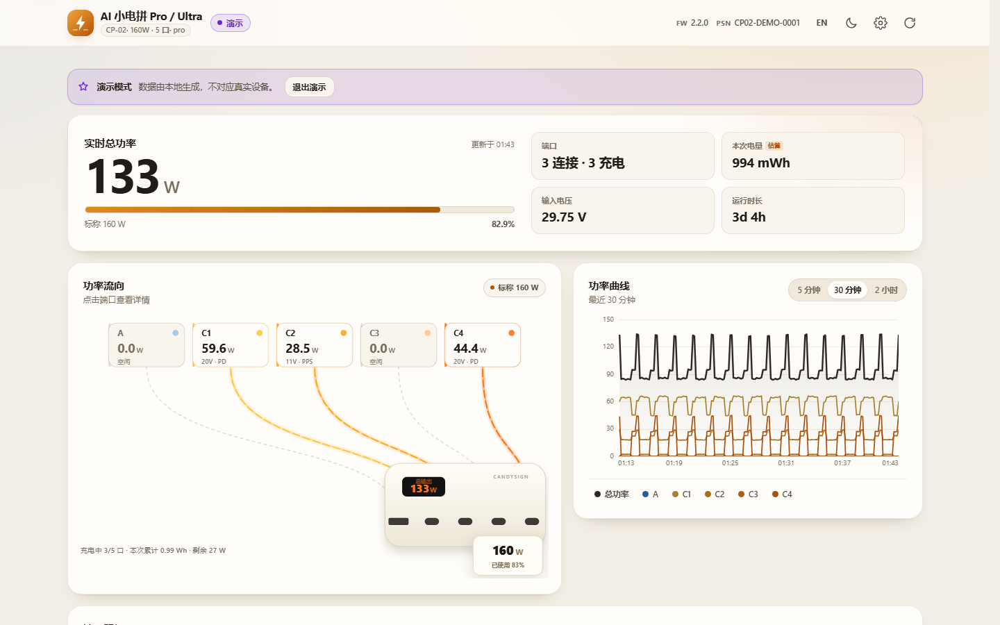

# AI 小电拼 · 实时功率看板

> 一个**只读、零依赖**的局域网 Web 仪表盘，把 CANDYSIGN 制糖工厂 AI 小电拼（CP-02 / Pro / Ultra，160 W 4C1A）的
> 五口实时功率、电压、电流、协议、充电时长与累计电量，画成 App 同款的功率分布图。
> 不装 App、不登录账号、不需要 MCP token，也不会修改充电器的任何设置。

[](LICENSE)
[](https://nodejs.org)
[](#)
[](https://wzqvip.github.io/cocan-ultra-dashboard/)

<p align="center">
  
</p>

| 竖屏手机 | 横屏手机 |
| --- | --- |
|  |  |

> 截图使用**演示数据**（`?demo=1`），不包含真实设备的 PSN / MAC / SSID / IP。

---

## 这是什么

小电拼 CP-02 本机自带一个 IonBridge HTTP 服务，暴露了：

- `GET /metrics.json`：五口实时电压/电流/协议/状态/会话电量，系统与 Wi-Fi 信息（推荐）
- `GET /metrics`：Prometheus 文本格式（同样数据，字段更少）
- `GET /porthistoryz?limit=180`：设备内存里约 30 分钟、10 秒/点的电压电流历史
- `GET /`：设备身份（PSN、型号、固件版本、端点列表）

这些接口**没有 CORS 头**，浏览器直接 `fetch` 会被拦；GitHub Pages 是 HTTPS，直接请求
`http://` 设备还会触发混合内容限制。所以本项目附带一个零依赖的本地 Node 代理：
它把设备数据归一化后，和静态页面同源提供。

```
┌────────────┐    same-origin     ┌──────────────┐    LAN / no CORS    ┌──────────────┐
│  Browser   │ ─────────────────► │  server.mjs  │ ──────────────────► │  CP-02       │
│  dashboard │  /api/snapshot     │  (Node 18+)  │  /metrics.json      │  IonBridge   │
└────────────┘                    └──────────────┘  /metrics           └──────────────┘
```

## 功能

- **App 同款功率分布图**：A、C1–C4 五个端口 chip，贝塞尔线连到机身；充电中的线有流动虚线，
  机身上显示总功率，右下角是标称 160 W 预算与使用率。
- **实时总览**：总功率、在充口数、本次累计电量、DC 输入母线电压、开机时长。
- **五口明细**：实时 W / V / A、快充协议（PD / PPS / QC / UFCS / VOOC…）、端口状态、
  本次充电时长、本次电量（由设备原始计数换算，±5% 估算）。
- **曲线**：设备自带 30 分钟历史 + 浏览器本地累积最长 2 小时（10 秒/点，仅页面打开期间）。
- **响应式 / 横竖屏**：竖屏手机、横屏手机、平板、桌面四档布局；支持刘海安全区、
  `100dvh`、无横向滚动；手机横屏时自动切成左右两栏。
- **主题与语言**：浅色 / 深色（跟随系统或手动切换）；中文 / English。
- **设备发现**：扫描本机所在 /24 网段，自动找出小电拼并填入地址；也支持 mDNS 主机名。
- **数据源可切换**：自动 / `metrics.json` / Prometheus `/metrics`；Prometheus 模式会明确标注
  「不提供充电时长与累计电量」。
- **演示模式**：`?demo=1` 或 GitHub Pages 自动使用合成数据，适合截图和 UI 开发。
- **无构建、无 npm 依赖、无 CDN**：原生 HTML/CSS/ES Modules，直接跑。

## 快速开始

需要 **Node.js 18+**（仅使用标准库，不需要 `npm install`）。

```bash
git clone https://github.com/wzqvip/cocan-ultra-dashboard.git
cd cocan-ultra-dashboard

# 把 <PSN> 换成你设备主机名里的序列号；也可以直接用 IP
node server.mjs --host cp02-<PSN>.local
```

打开 <http://127.0.0.1:8787>。默认端口是 8787；如果被占用或落在 Windows 保留端口段，
会自动顺延到下一个可用端口并在终端打印实际地址。

Windows 也可以双击 `start.bat`（可带参数：`start.bat --host 192.168.1.20`）。
macOS / Linux 用 `./start.sh`。

**不知道设备地址？** 启动后打开页面 → 右上角设置 → 扫描局域网，或直接输入 IP。
不传 `--host` 时，页面会提示先配置设备。

> `.local` 主机名依赖 mDNS。部分 Windows 机器没装 Bonjour，解析不了 `.local`，
> 这时用路由器后台看到的 IP 即可；扫描功能也会直接返回 IP。

### 手机上打开

```bash
node server.mjs --host cp02-<PSN>.local --lan
```

终端会打印 `http://192.168.x.x:8787`，同一 Wi-Fi 下的手机即可访问。

> ⚠ `--lan` 会把代理暴露给同一局域网，且**没有鉴权**。只建议在可信家庭网络使用；
> 默认绑定 `127.0.0.1`，其他人访问不到。代理只允许访问内网 / `.local` 目标，避免成为 SSRF 跳板。

## 能读什么，不能读什么

| 能力 | 本看板（局域网只读） | 官方 App |
| --- | --- | --- |
| 五口实时功率 / 电压 / 电流 | ✅ | ✅ |
| 快充协议 | ✅ | ✅ |
| 本次充电时长 / 本次电量 | ✅（电量 ±5% 估算） | ✅ |
| 30 分钟曲线 | ✅ 设备内存 | ✅ |
| 2 小时曲线 | ✅ 仅页面打开期间（localStorage） | ✅ 云端 |
| 总功率 / 在充口数 / 端口状态 | ✅ | ✅ |
| 设备身份 / 固件 / Wi-Fi / 系统负载 | ✅ | 部分 |
| 充电策略（自由流 / 睡眠充 / 魔拟充 / 极速单充…） | ❌ 写操作，且读不到当前策略 | ✅ |
| 单口开关 / 温控模式 / 屏幕亮度 | ❌ 需 MCP token | ✅ |
| 芯片温度 / 在充设备识别 / 充满时间 | ❌ 需 MCP / 云端 | ✅ |
| OTA / 家庭共享 / 远程控制 | ❌ | ✅ |

控制类功能需要官方 **MCP token**，等同于设备控制密码。本仓库**不读取、不保存、不要求**
任何 token；本项目是纯只读看板。更细的 App 对齐说明与证据见
[docs/APP-PARITY.md](docs/APP-PARITY.md)。

## 数据从哪来

| 端点 | 内容 | 本看板用途 |
| --- | --- | --- |
| `/metrics.json` | 端口数组 + system + wifi + tasks | **首选**，信息最全 |
| `/metrics` | Prometheus 文本，端口电压/电流/协议 + 系统指标 | 自动回退 / 手动切换 |
| `/porthistoryz?limit=180` | 10 s/点、约 30 min 历史 | 曲线种子 |
| `/` | `window.__INFOZ` / `__ENDPOINTS` | 设备身份、固件版本 |

本项目的代理接口（都只在本机 `127.0.0.1`）：

| 接口 | 作用 |
| --- | --- |
| `GET /api/snapshot?host=&mode=auto\|json\|prometheus` | 归一化后的实时快照 |
| `GET /api/history?host=&limit=180` | 归一化后的历史曲线 |
| `GET /api/info?host=` | 设备身份与能力 |
| `GET /api/scan` | 扫描本机 /24 网段 |
| `GET /api/health` | 服务状态 |

完整字段、单位与协议枚举见 [docs/DATA-CONTRACT.md](docs/DATA-CONTRACT.md)。

几个容易踩坑的语义：

- `session_charge` 是 SW3566 的**原始计数**，`× 24.552 = µWs`，再 `/3.6e9` 得到 Wh。
  这是估算值（约 ±5%），不是设备直接上报的 Wh。
- `fc_protocol = 0` 表示「无快充协议，可能仍在 5V 普通充电」；`255` 才是「未充电」。
- **160 W 是整机标称预算**，不是 `/metrics.json` 里的实时字段；每口 `power_budget` 是该口的分配上限。
- `system.boot_time_seconds` 实际是「开机以来的秒数」（uptime），命名有点误导。
- `pd_status` 在 2.2.0 固件上恒为 `null`，不要依赖。

## Prometheus 集成

设备自带的 `/metrics` 就是标准 Prometheus 文本格式，直接抓即可：

```yaml
# prometheus.yml
scrape_configs:
  - job_name: cocan-cp02
    metrics_path: /metrics
    scrape_interval: 10s
    static_configs:
      - targets: ["cp02-<PSN>.local:80"]
```

常用 PromQL：

```promql
# 五口总输出功率（W）
sum(ionbridge_port_voltage * ionbridge_port_current) / 1e6

# 每口功率（W）
(ionbridge_port_voltage * ionbridge_port_current) / 1e6

# Wi-Fi 信号 / 剩余堆 / 开机时长
ionbridge_wifi_signal
ionbridge_free_heap
ionbridge_uptime_seconds
```

看板支持 `mode=prometheus`（设置里可选），但该端点**没有**充电时长、累计电量、
`attached` 状态和端口类型；看板会根据电压推断连接状态，并把缺失字段显示为「—」而不是 0。
需要完整信息时用 `/metrics.json`。

> 说明：设备是 HTTP 且只监听局域网。Prometheus 跑在同一内网没问题；跨网段/公网抓取
> 需要自己加隧道或 exporter，本仓库不包含。

## 界面与交互

- **功率分布图**：点任意端口 chip 选中该口，再点端口列表或曲线即可打开详情。
- **曲线**：5 分钟 / 30 分钟 / 2 小时切换；图例可单独开关每个端口；鼠标悬停或触摸查看数值。
- **设置**：设备地址、数据源、轮询间隔（默认 3 s）、扫描局域网、主题、语言。
  地址与偏好保存在 `localStorage`，不上传。
- **状态**：`实时` / `演示` / `离线` / `数据过期`；连续失败会保留最后一次数据并提示重试。
- **横竖屏**：竖屏单列、横屏左右两栏、桌面 2–3 栏；旋转屏幕无需刷新。
- **无障碍**：键盘可操作、可见焦点环、`aria-live` 节流播报、支持 `prefers-reduced-motion`。

<p align="center">
  
</p>

<p align="center"><sub>端口详情：移动端底部抽屉，实时数值、协议、本次电量与固件状态。</sub></p>

## 部署

### GitHub Pages（演示站）

`.github/workflows/pages.yml` 在每次 push 到 `main` 时，把 `index.html` + `assets/` 原样发布到
GitHub Pages，没有构建步骤。Pages 上的页面会自动进入**演示模式**：

- HTTPS 页面不能请求 `http://` 设备（混合内容限制）；
- 设备本身也不发 CORS 头。

所以想要真实数据，请在本地/局域网跑 `server.mjs`；Pages 只用于展示 UI。
如需从公网看真机，可自己加一层 HTTPS 反向代理/VPN，本仓库不提供。

### 本地常驻（可选）

把 `start.bat` 放进任务计划程序，或 macOS/Linux 用 systemd/launchd 拉起
`node server.mjs --host <host>` 即可。代理无状态，不写任何配置文件。

## 隐私与安全

- 仓库、演示数据和截图里**不包含**真实 PSN、MAC、SSID、BSSID 或设备 IP；示例统一用占位符。
- 演示数据由 `assets/js/demo.js` 合成，设备地址固定为 `demo.local`。
- 代理默认只监听 `127.0.0.1`；`--lan` 需显式开启，且没有鉴权。
- 代理拒绝访问公网目标（`--allow-any` 可显式放开，不建议）。
- 不读取、不保存、不要求 MCP token；不调用任何写接口。
- 设备端 `/metrics*` 本身无鉴权，同一 Wi-Fi 下任何人都能读——这是设备固件的行为，本看板没有扩大权限。

## 项目结构

```
.
├── index.html                 # 单页仪表盘
├── assets/
│   ├── css/                   # 设计 token、布局、组件、响应式
│   └── js/
│       ├── app.js             # 状态与渲染
│       ├── data.js            # 代理客户端、HistoryStore、格式化
│       ├── demo.js            # 合成演示数据
│       ├── diagram.js         # SVG 功率分布图
│       ├── charts.js          # Canvas 曲线
│       ├── i18n.js            # 中文 / English
│       └── protocols.js       # 协议枚举与端口配色
├── server.mjs                 # 零依赖静态服务 + 设备代理 + 网段扫描
├── lib/metrics.mjs            # 归一化 / Prometheus 解析 / 历史映射（可单测）
├── test/metrics.test.mjs      # node --test
├── docs/
│   ├── DATA-CONTRACT.md       # 前端唯一数据契约
│   ├── APP-PARITY.md          # 与 App 的对齐规格、来源与风险
│   └── screenshots/           # README 截图（演示数据）
├── start.bat / start.sh
└── .github/workflows/pages.yml
```

## 开发与测试

```bash
node --test                 # 归一化 / Prometheus / 历史 / 协议单测
node server.mjs --host <host>
```

纯静态、无打包。改完 JS/CSS 刷新页面即可。代理接口的样例：

```bash
curl http://127.0.0.1:8787/api/health
curl http://127.0.0.1:8787/api/snapshot?mode=json
curl http://127.0.0.1:8787/api/history?limit=180
curl http://127.0.0.1:8787/api/scan
```

## 已知限制

- 固件 2.2.0 实测；不同固件/型号（CP-02S、CP-01）字段可能有差异，未知协议值会显示为「未知 (n)」。
- `pd_status` 为 `null`：PD 档位、线材、在充设备识别无法从局域网获得。
- 设备历史只有约 30 分钟；2 小时曲线只在页面打开期间记录，换浏览器/清缓存会丢。
- 本次电量是换算估算，不是库仑计直读；会话切换后以设备新会话为准。
- 160 W 是标称预算；实际分配由设备策略决定，本看板无法读取当前策略。
- `.local` 解析在部分 Windows 上不可用；用 IP 或扫描。
- 截图与 demo 均为合成数据，不代表任何真实设备状态。

## 排错

| 现象 | 处理 |
| --- | --- |
| 页面一直「未配置设备」 | 启动时加 `--host`，或在设置里填 IP / 扫描局域网 |
| `无法连接设备（连接超时）` | 确认电脑与充电器在同一 2.4G Wi-Fi；先用浏览器打开 `http://<IP>/metrics.json` |
| `.local` 打不开 | 安装 Bonjour，或直接用路由器里看到的 IP |
| 端口被占用 | 换 `--port 8790`；默认会自动顺延并打印实际端口 |
| 页面显示「演示数据」 | 你在 GitHub Pages 或用 `?demo=1` 打开；本地 `http://127.0.0.1` 才是真机 |
| 只有 Prometheus 模式 | 设置里切回「自动」；Prometheus 不提供时长/电量 |
| 手机打不开 | 用 `--lan` 启动，并允许 Windows 防火墙的专用网络访问 |

## 致谢与来源

- 官方固件开源仓库 [ifanrx/IonBridge](https://github.com/ifanrx/IonBridge)：协议枚举、端口状态机、
  SW3566 电量换算系数的参考（本仓库未复制其代码）。
- 社区项目 [hwisdom-jpg/cocan-web](https://github.com/hwisdom-jpg/cocan-web)（MIT）、
  [yangyihang96/CoCanBar](https://github.com/yangyihang96/CoCanBar)（MIT）、
  [LeiZiKang/KangCharge](https://github.com/LeiZiKang/KangCharge)（MIT）：功率分布图的几何比例与
  App 功能边界的重要参考。
- CANDYSIGN / 制糖工厂 / 小电拼 / CoCan / FluxAI 是厂商标识。

> **非官方项目**：本项目由社区维护，与 CANDYSIGN 无隶属、无背书关系。使用风险自负；
> 只读接口无鉴权，请勿在公共网络暴露代理。

## License

[MIT](LICENSE) © 2026 wzqvip
